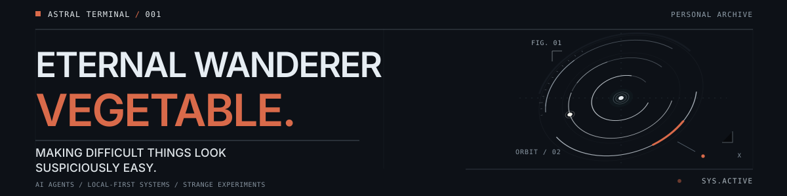
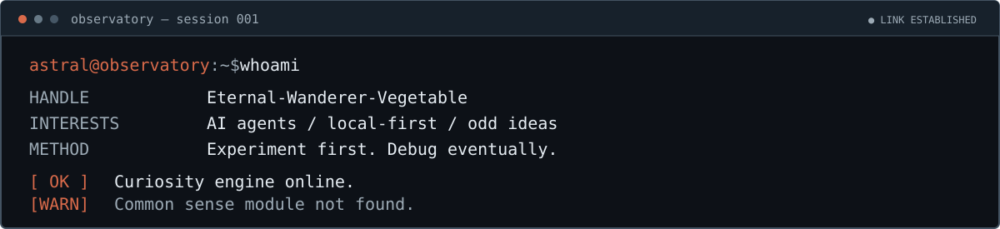

<p align="right">
  <a href="./README_CN.md">简体中文</a> &nbsp; / &nbsp; <strong>English</strong>
</p>

<div align="center">
  
  <p><em>“We do these things not because they are easy, but because we thought they should be easy.”</em></p>
</div>

<!-- 01 / IDENTITY -->




I build AI agents, developer tools, and software experiments that tend to begin with the words *“How hard could it be?”* I prefer practical tools, local-first thinking, and learning by making things slightly more complicated than expected.

<!-- 02 / EXPERIMENT REGISTRY -->


<!-- Registry maintenance: edit the Markdown table rows directly. Keep README_CN.md in sync. No SVG changes required. -->

| Ref. | Experiment | Field notes |
| :--- | :--- | :--- |
| `01` | **[Stella](https://github.com/Eternal-Wanderer-Vegetable/Stella_project)** | Model-agnostic QQ-group AI agent. Local or online LLMs, extensible tools, and cost-conscious design. |
| `02` | **[Caligo](https://github.com/Eternal-Wanderer-Vegetable/Caligo)** | Experimental Rust framework for modern NTQQ protocol clients. |
| `03` | **[Athanor Studio](https://github.com/Eternal-Wanderer-Vegetable/Athanor_Studio)** | Structured documents, robust conversion, versioning, and information preservation. |
| `04` | **[Kevin_Kelly-Game](https://github.com/Eternal-Wanderer-Vegetable/Kevin_Kelly-Game)** | Experimental harness for evolving coding agents through controlled self-rewrite, mutation, and independent evaluation. |

<sub>`index.status: expanding` &nbsp; · &nbsp; Selected public projects from my own repositories, not the full archive.</sub>

<!-- 03 / FIELD NOTES -->


```python
while tokens_available():
    claim()
    experiment()  # "How hard could it be?"
    if rate_limited():
        sleep(3600)  # Officially classified as rest.
```

*The rate limit is just a suggestion, right?* (This is a joke. Probably.)

<!-- 04 / OPEN CHANNEL -->


**Toolchain / Installed modules**

[](https://www.python.org/)
[](https://www.rust-lang.org/)
[](https://tauri.app/)
[](https://www.typescriptlang.org/)
[](https://vuejs.org/)
[](https://developer.mozilla.org/en-US/docs/Web/JavaScript)
[](https://nodejs.org/)
[](https://go.dev/)
[](https://www.docker.com/)

Open to interesting conversations and collaborations involving **AI agents**, **local-first software**, **developer tooling**, or just an idea that sounds a little unreasonable.

**Transmission address:** [1694717255@qq.com](mailto:1694717255@qq.com)

<sub><code>astral@observatory:~$ exit</code> &nbsp; · &nbsp; Connection closed. Curiosity still running.</sub>
